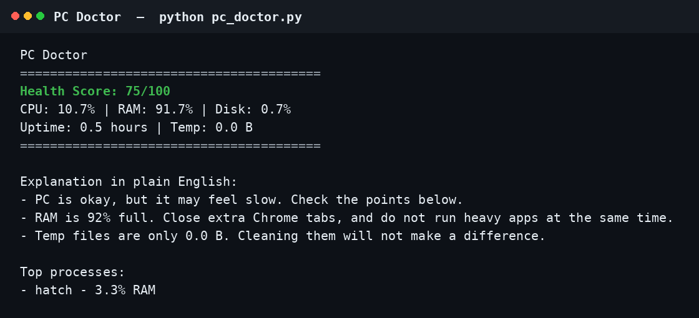
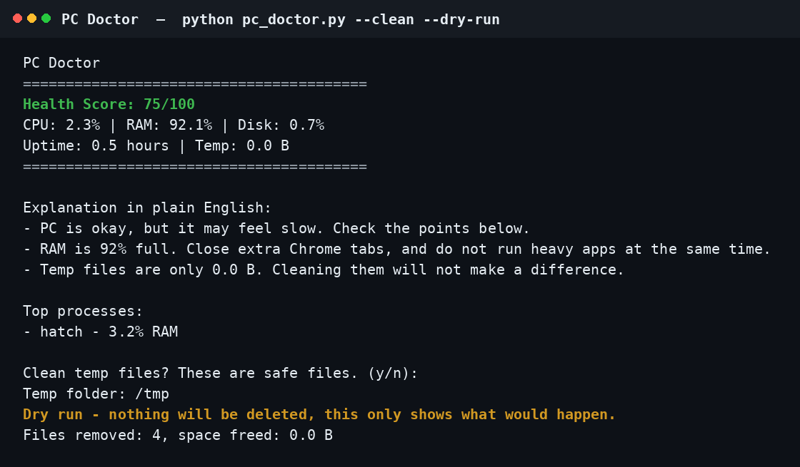

# PC Doctor

Made by Mayur - github.com/Mayurchavan2005 / instagram.com/vibe.coderr_

## Problem

My PC becomes slow, but Windows only shows numbers like CPU 90% and RAM 85%. Most of my friends and family do not understand what those numbers mean, and they are scared to delete files because they do not know what is safe to delete.

I wanted a tool that checks the PC and explains the problem in plain English, in simple words, and only suggests safe cleanup.

## What it does

- Checks CPU, RAM, Disk, Battery and Uptime
- Gives a Health Score from 0 to 100
- Explains each problem in plain English, for example if RAM is 85% full it says to close extra Chrome tabs
- Shows top 5 processes by RAM use
- Checks temp files size and can clean only safe temp files
- Can save a report in pc_report.txt

It does not delete personal files. With --clean it only touches the temp folder, and it asks for confirmation first.

## How to run

Python 3.8 or above is needed.

Install one library:

```
pip install -r requirements.txt
```

Check the PC:

```
python pc_doctor.py
```

Clean temp files (it will ask y/n first):

```
python pc_doctor.py --clean
```

First see what will be deleted, without deleting:

```
python pc_doctor.py --clean --dry-run
```

Save a report:

```
python pc_doctor.py --report
```

## Screenshots

Real output from a test run:





## Tech used and why

Python, because I know it and it is easy to run on Windows.

psutil, because it gives CPU, RAM, disk and process data in a few lines. I did not want to write Windows-only code for this, so psutil was the right choice.

No other library. I kept it to one library so the setup stays simple.

## How the health score works

This is my own logic. Score starts at 100.

- RAM above 85% : minus 25. Above 70% : minus 15.
- CPU above 80% : minus 20. Above 60% : minus 10.
- Disk above 90% : minus 25. Above 80% : minus 15.
- Temp files above 1 GB : minus 10. Above 500 MB : minus 5.
- Uptime above 72 hours : minus 5.

The score is only a simple guide, not a medical check. The plain English lines matter more than the number.

## Tested result

On a test run on 15 November 2026, the tool gave a Health Score of 75/100. RAM was 92% full, so 25 points were taken off for RAM. CPU was 11%, disk was 1% full, and temp files were 0 B, so nothing was taken off for those. An earlier test run on 10 November 2026 gave the same score of 75/100 for the same reason: RAM was 92% full.

## What was difficult

1. Temp folder cleanup failed on some files because Windows was using them. I fixed this by skipping files that give a permission error, instead of stopping the whole cleanup.

2. Battery data is not available on a desktop PC. The first version crashed there. I fixed it by checking if battery data exists before using it.

3. Some processes do not allow reading their data. I added a check for that and skip those processes.

4. When I tested --clean without typing anything, the program crashed with an EOF error. I fixed it by treating no input as "no".

## What I learned

- How CPU, RAM and disk use are linked to a slow PC
- How to read process data safely without crashing the program
- How to write a tool that explains a technical problem in simple language

## What I would improve next

- Add a simple GUI for people who do not use the terminal
- Add a check for startup apps that slow down boot time
- Add a weekly report that compares this week with last week

## How I built it

I used AI for boilerplate code and for debugging. The idea, the plain English rules, the health score weights and the decision of what is safe to delete are mine.
